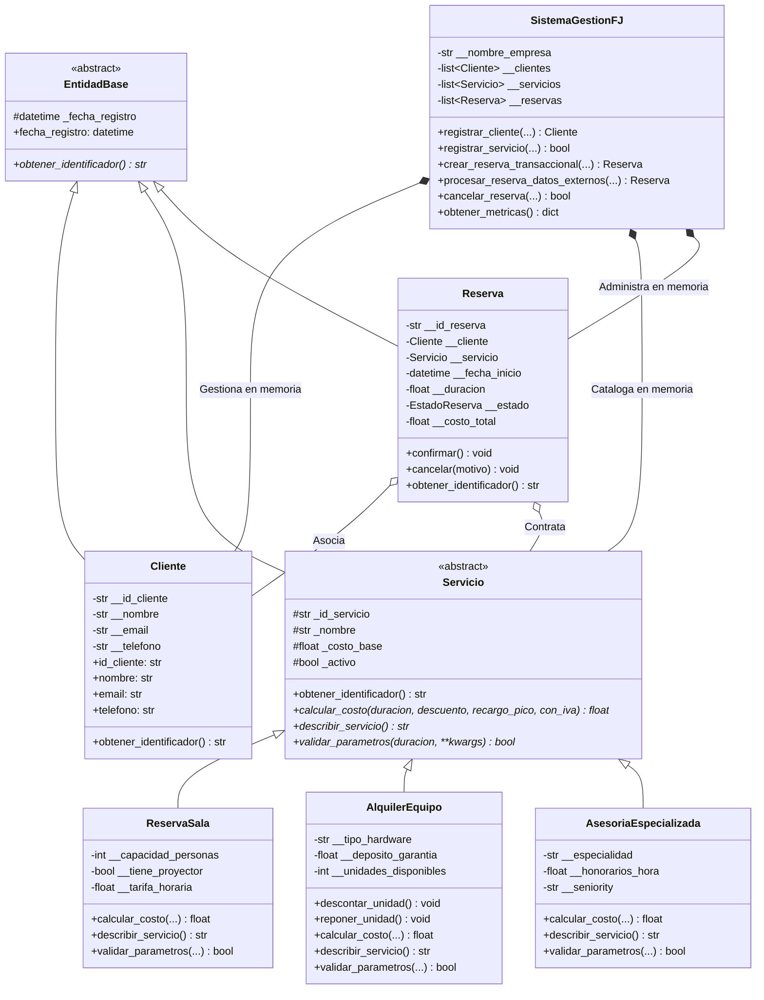
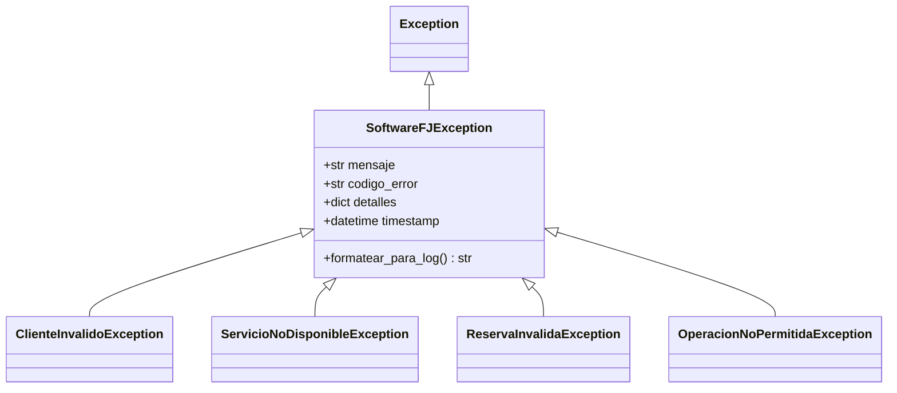

# UNAD - Fase 4: Componente Práctico (Prácticas Simuladas)
## Sistema Integral de Gestión de Clientes, Servicios y Reservas - Software FJ


---

### Datos Institucionales
- **Institución:** Universidad Nacional Abierta y a Distancia (UNAD)
- **Escuela:** Escuela de Ciencias Básicas, Tecnología e Ingeniería (ECBTI)
- **Programa:** Ingeniería de Sistemas
- **Curso:** Programación (Código: 213023)
- **Actividad:** Fase 4 - Componente Práctico (Prácticas Simuladas)
- **Estudiante Desarrollador:** Marco Steven Rodríguez Montoya
- **Puntaje Objetivo:** 150 / 150 Puntos

---

## 1. Descripción del Problema y Alcance

La empresa tecnológica **Software FJ** comercializa tres líneas especializadas de servicios corporativos:
1. **Reserva de Salas:** Espacios físicos para conferencias y reuniones equipados con tecnología audiovisual.
2. **Alquiler de Equipos:** Préstamo de infraestructura de hardware (servidores, laptops especializadas, switches) con control físico de stock y depósitos de garantía.
3. **Asesorías Especializadas:** Consultoría técnica profesional en áreas avanzadas de ingeniería (Cloud Computing, DevOps, Ciberseguridad) tasada según la experiencia del especialista (*Junior*, *Senior*, *Master*).

### Reglas de Negocio y Restricciones Técnicas
- **Cero Motores de Bases de Datos:** Todo el modelo opera estrictamente en memoria mediante objetos tipados y listas internas (`__clientes`, `__servicios`, `__reservas`), conforme lo exige el **Anexo 3**.
- **Persistencia de Auditoría:** Toda la actividad transaccional, errores y eventos se registran de forma estructurada en disco a través del archivo `software_fj.log`.
- **Resiliencia Total:** La aplicación debe procesar errores graves y datos anómalos sin interrumpir jamás el hilo principal de ejecución (código de salida garantizado: `0`).

---

## 2. Arquitectura de Software y Modelado Orientado a Objetos

El diseño implementa de forma rigurosa los cuatro pilares fundamentales de la Programación Orientada a Objetos (POO): **Abstracción**, **Encapsulación**, **Herencia** y **Polimorfismo**, sumando la **Sobrecarga de Métodos simulada**.

### Diagrama de Clases del Sistema (Mermaid)



### Jerarquía de Excepciones Personalizadas



---

## 3. Patrones de Manejo de Excepciones y Robustez

El proyecto implementa todas las modalidades de gestión de errores requeridas por la rúbrica de evaluación:

1. **`try / except` (Captura Defensiva):** Utilizado en el registro de clientes y validación de tipos, evitando que inconsistencias de entrada aborten la ejecución.
2. **`try / except / else` (Transaccionalidad en Memoria):** En `SistemaGestionFJ.crear_reserva_transaccional()`, el bloque `else` garantiza que una reserva se incorpore a la lista interna `__reservas` **únicamente si** todas las validaciones de negocio concluyeron sin disparar excepciones.
3. **`try / except / finally` (Auditoría y Liberación de Recursos):** El bloque `finally` se ejecuta invariablemente en cada transacción de reserva para auditar el resultado (`EXITOSA_CONFIRMADA` o `FALLIDA_NEGOCIO`), dejando constancia en el log y verificando la coherencia del estado.
4. **Encadenamiento de Excepciones (`raise ... from ...`):** En `procesar_reserva_datos_externos()`, las fallas nativas (`ValueError` al parsear fechas o tipos numéricos) son capturadas y relanzadas como `ReservaInvalidaException` mediante `raise ReservaInvalidaException(...) from err_origen`. Esto preserva el traceback original en el atributo `__cause__` y lo plasma en el log.

---

## 4. Estructura del Proyecto

```text
tarea0411/
│
├── software_fj/
│   ├── __init__.py                 # Metadatos del paquete Software FJ
│   ├── exceptions.py               # Jerarquía de 5 excepciones personalizadas
│   ├── logger_config.py            # FileHandler (software_fj.log) y StreamHandler (consola)
│   │
│   ├── models/
│   │   ├── __init__.py             # Exportaciones del submódulo models
│   │   ├── base.py                 # EntidadBase (Clase abstracta con obtener_identificador)
│   │   ├── cliente.py              # Cliente con encapsulación estricta (__), @property y setters
│   │   ├── servicios.py            # Servicio (ABC), ReservaSala, AlquilerEquipo, AsesoriaEspecializada
│   │   └── reserva.py              # Reserva, EstadoReserva (Enum), transiciones de estado
│   │
│   └── core/
│       ├── __init__.py             # Exportaciones del submódulo core
│       └── sistema.py              # SistemaGestionFJ (Gestor con listas internas y try/except/else/finally)
│
├── main.py                         # Suite automatizada con las 10 operaciones de simulación
├── software_fj.log                 # Archivo de auditoría generado automáticamente
├── .gitignore                      # Reglas de exclusión para Python y entornos
└── README.md                       # Documentación técnica completa del proyecto
```

---

## 5. Suite de Simulación (10 Operaciones Obligatorias)

El script `main.py` ejecuta en serie 10 operaciones exhaustivas que demuestran la funcionalidad completa y la resiliencia del software:

| # | Operación | Tipo | Entrada / Acción | Resultado Esperado | Manejo Técnico |
|---|:---|:---:|:---|:---|:---|
| **01** | Registro de Cliente Válido | Válida | `id="CLI-1001"`, `nombre="Carlos Andrés Mendoza"`, `email="carlos.mendoza@empresa.com"`, `tel="3159876543"` | Cliente almacenado en lista interna. | Setters con `@property` y validación regex. |
| **02** | Reserva de Sala de Juntas | Válida | `id="RES-001"`, Sala Magna con proyector, duración: 4 horas, con IVA (19%). | Reserva confirmada. Total: $422,450.00 COP. | Bloque `try-except-else-finally` transaccional. |
| **03** | Alquiler de Equipo de Cómputo | Válida | Servidor Blade 64GB, duración: 3 días, depósito: $500,000. | Alquiler confirmado. Total: $1,392,500.00 COP. Stock pasa de 2 a 1 ud. | Descuento físico de inventario en bodega. |
| **04** | Asesoría Especializada Cloud | Válida | Consultor Master (multiplicador x2.2), duración: 5 horas, 10% descuento, 15% recargo pico, con IVA. | Asesoría liquidada con sobrecarga. Total: $2,032,222.50 COP. | Sobrecarga de método simulada con parámetros por defecto. |
| **05** | Cancelación Controlada | Válida | Solicitud de cancelación formal de la reserva `RES-002`. | Estado cambia a `CANCELADA`. Stock de servidor restituido de 1 a 2 uds. | Desacoplamiento de recursos y trazabilidad en log. |
| **06** | Registro con Email Inválido | Inválida | `email="correo_invalido_sin_arroba"` (sin `@` ni dominio). | Operación rechazada. Hilo principal continúa activo. | Captura de `ClienteInvalidoException`. |
| **07** | Reserva con Duración Negativa | Inválida | Duración: `-4.0` horas en reserva de sala. | Operación rechazada por valor no positivo. | Captura de `ReservaInvalidaException`. |
| **08** | Alquiler sin Stock en Bodega | Inválida | Solicitud de Laptop `SRV-EQ-LAP99` con inventario en 0 uds. | Operación rechazada por falta de existencias físicas. | Captura de `ServicioNoDisponibleException`. |
| **09** | Re-cancelación Anómala | Inválida | Intentar cancelar por segunda vez la reserva `RES-002` ya cancelada. | Rechazo de transición ilegal en máquina de estados. | Captura de `OperacionNoPermitidaException`. |
| **10** | Inyección de Datos Corruptos | Inválida | `fecha_str="FECHA-CORRUPTA-2026/99/99"`, `duracion_str="CINCO_HORAS_TEXTO"`. | Conversión fallida encadenada con `raise ... from err_fecha`. | Traceback completo preservado en `software_fj.log`. |

### Resultado de la Ejecución Automatizada
```text
Total Operaciones Procesadas       : 16 (10 de simulación + 6 de configuración)
Excepciones Controladas en Memoria : 5
Clientes Activos en Memoria        : 3
Servicios en Catálogo en Memoria   : 4
Reservas en Memoria                : 3 (Confirmadas: 2, Canceladas: 1)
Índice de Resiliencia / Estabilidad: 100.0% (Código de salida del sistema: 0)
Archivo de Auditoría               : software_fj.log generado exitosamente.
```

---

## 6. Instrucciones de Ejecución

### Prerrequisitos
- Python 3.10 o superior (verificado con Python 3.12).
- Git para control de versiones.

### Pasos para Ejecutar
1. Clonar el repositorio o ubicarse en la carpeta raíz del proyecto:
   ```bash
   cd tarea0411
   ```
2. Ejecutar la suite principal de simulación:
   ```bash
   python main.py
   ```
3. Verificar el archivo de auditoría generado:
   ```bash
   # En Windows PowerShell:
   Get-Content software_fj.log -Tail 30

   # En Linux / macOS:
   tail -n 30 software_fj.log
   ```

---

## 7. Flujo de Trabajo Profesional en GitHub (Git Flow)

Para dar cumplimiento estricto a los **30 puntos del Criterio 4 de la Rúbrica de Evaluación**, el proyecto implementa una estrategia de ramas estructuradas, commits semánticos, Pull Requests simulados e Issues temáticos asignados:

### Ramas de Desarrollo
- `main`: Rama de producción protegida que contiene la versión estable y documentada.
- `feature/exceptions-logging`: Desarrollo de la jerarquía de excepciones y subsistema de logging.
- `feature/domain-models`: Implementación de `EntidadBase`, `Cliente` y validaciones encapsuladas.
- `feature/services-polymorphism`: Jerarquía de `Servicio`, polimorfismo y sobrecarga en salas, equipos y asesorías.
- `feature/booking-system`: Clase `Reserva`, máquina de estados y gestor en memoria `SistemaGestionFJ`.
- `feature/simulation-tests`: Suite de simulación con las 10 operaciones y verificación de resiliencia.

### Convención de Commits Semánticos
- `feat:` Nuevas funcionalidades o clases del modelo.
- `fix:` Ajustes defensivos o corrección de excepciones.
- `docs:` Documentación, README y diagramas.
- `test:` Casos de prueba y simulaciones de resiliencia.

---

## 8. Referencias Bibliográficas (Normas APA 7.ª Edición)

- Cuevas Álvarez, A. (2016). *Python 3: curso práctico* (1.ª ed.). RA-MA Editorial.
- Fabrizio, R., Baka, B., & Phillips, D. (2019). *Getting Started with Python: Understand Key Data Structures and Use Python in Object-oriented Programming*. Packt Publishing.
- Python Software Foundation. (2024). *Errors and Exceptions — Python 3.12 Documentation*. https://docs.python.org/3/tutorial/errors.html
- Python Software Foundation. (2024). *Logging facility for Python — Python 3.12 Documentation*. https://docs.python.org/3/library/logging.html
- Silva, F. D. (2025). *Basics of using GitHub*. Repositorio Institucional UNAD.
- Van Rossum, G., & Drake Jr, F. L. (2024). *El tutorial de Python*. Python Software Foundation.
- Zambrano, J. P. (2025). *Introducción al uso de GitHub* [Objeto Virtual de Información - OVI]. Repositorio Institucional UNAD. https://repository.unad.edu.co/handle/10596/75876
