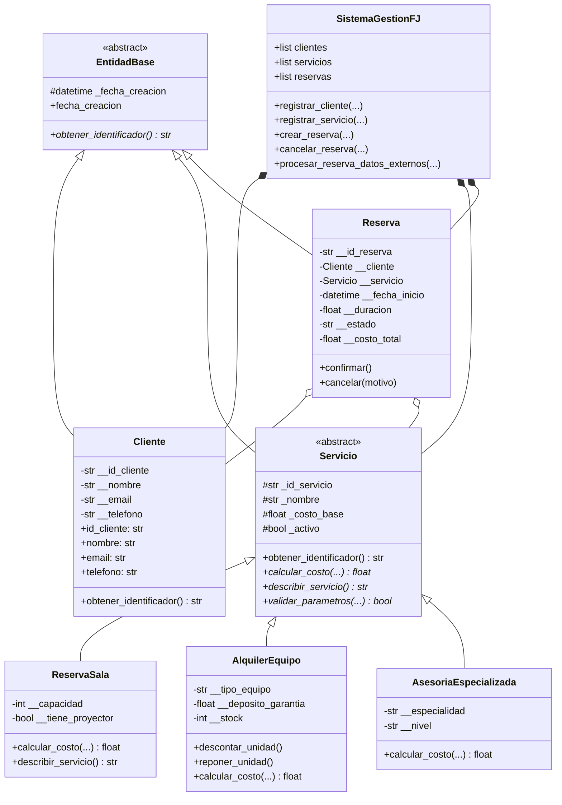

# Software FJ - Sistema de Gestión de Servicios y Reservas
### Universidad Nacional Abierta y a Distancia (UNAD)
**Curso:** Programación (213023)  
**Fase:** Fase 4 - Componente Práctico (Prácticas Simuladas)  
**Estudiante:** Marco Steven Rodríguez Montoya  

---

### Repositorio en GitHub
- **URL del Repositorio:** https://github.com/korkito1-rgb/UNAD-Fase4-SoftwareFJ
- **Usuario:** korkito1-rgb (Marco Steven Rodríguez Montoya)

Este proyecto corresponde a la solución práctica solicitada en el **Anexo 3** de la actividad. Se trata de un sistema orientado a objetos desarrollado en **Python** para la empresa **Software FJ**, la cual se encarga de gestionar tres líneas de servicios:

1. **Reserva de Salas:** Alquiler de espacios de trabajo y salas de juntas por horas, con cobro adicional si incluye proyector.
2. **Alquiler de Equipos:** Alquiler de hardware (servidores, portátiles) por días, controlando el inventario físico en bodega y cobrando un depósito de garantía reembolsable.
3. **Asesorías Especializadas:** Consultoría técnica tasada por horas, con multiplicadores según la experiencia del profesional (*Junior*, *Senior*, *Master*).

### Restricciones clave de la actividad:
- **Sin bases de datos:** Toda la información se maneja en memoria utilizando objetos y listas nativas (`self.clientes`, `self.servicios`, `self.reservas`).
- **Manejo de archivos:** Se utiliza exclusivamente para el archivo de logs (`software_fj.log`), donde se registran los eventos normales y las excepciones.
- **Resiliencia y estabilidad:** El sistema está preparado con manejo avanzado de excepciones para que, ante datos inválidos o errores de negocio, el programa no se interrumpa y termine con código de salida `0`.

---

## 2. Arquitectura Orientada a Objetos (POO)

El sistema aplica los pilares fundamentales de la programación orientada a objetos:

- **Abstracción:** Se define la clase abstracta `EntidadBase` (usando el módulo `abc`) con el método abstracto `obtener_identificador()`, del cual derivan `Cliente`, `Servicio` y `Reserva`.
- **Encapsulación:** En la clase `Cliente` los atributos son estrictamente privados (`__id_cliente`, `__nombre`, `__email`, `__telefono`). El acceso se realiza con decoradores `@property` y `@setter`, validando que el correo tenga `@` y punto, y que el teléfono sea numérico.
- **Herencia y Polimorfismo:** La clase abstracta `Servicio` define los métodos abstractos `calcular_costo()`, `describir_servicio()` y `validar_parametros()`. Sus hijas (`ReservaSala`, `AlquilerEquipo`, `AsesoriaEspecializada`) implementan cada una su propia lógica.
- **Simulación de Sobrecarga:** En Python no existe la sobrecarga estática tradicional (por tipo y número de argumentos en tiempo de compilación). Para cumplir con este requisito del Anexo 3, el método `calcular_costo()` utiliza argumentos con valores por defecto (`duracion=1.0`, `descuento=0.0`, `recargo_pico=0.0`, `con_iva=True`), permitiendo diferentes variantes de cálculo en una sola llamada.

### Diagrama de Clases



---

## 3. Jerarquía y Manejo de Excepciones

Para evitar el uso de excepciones genéricas, se construyó una jerarquía propia que hereda de `Exception`:

- `SoftwareFJException(Exception)`: Clase padre con código de error, mensaje y fecha.
  - `ClienteInvalidoException`: Para datos vacíos, correos mal formados o teléfonos no numéricos.
  - `ServicioNoDisponibleException`: Cuando se intenta alquilar un equipo sin inventario en bodega o el servicio está inactivo.
  - `ReservaInvalidaException`: Para reservas con duración <= 0 o fechas corruptas.
  - `OperacionNoPermitidaException`: Para transiciones ilegales, por ejemplo, intentar cancelar una reserva que ya está cancelada.

### Patrones de control implementados:
1. **`try / except`:** Se usa en la validación de clientes y conversión de tipos para capturar errores sin detener el sistema.
2. **`try / except / else`:** En el método `crear_reserva()`, la reserva se añade a la lista en memoria **únicamente dentro del bloque `else`**, asegurando que solo se guarde si el bloque `try` finalizó sin ninguna excepción.
3. **`try / except / finally`:** El bloque `finally` se ejecuta siempre para dejar registro en el log del resultado de la transacción (auditoría), independientemente de si fue exitosa o rechazada.
4. **Encadenamiento de excepciones (`raise ... from ...`):** En `procesar_reserva_datos_externos()`, si la fecha no puede convertirse (`ValueError`), se lanza `ReservaInvalidaException` encadenada:
   ```python
   try:
       fecha_dt = datetime.strptime(fecha_str, "%Y-%m-%d %H:%M")
   except ValueError as err_fecha:
       raise ReservaInvalidaException(
           f"El formato de la fecha '{fecha_str}' es incorrecto."
       ) from err_fecha
   ```
   Esto guarda el rastro del error nativo en el atributo `__cause__` y queda registrado en el archivo de log con su traceback completo.

---

## 4. Estructura de Carpetas

```text
tarea0411/
│
├── software_fj/
│   ├── __init__.py           # Datos del paquete
│   ├── exceptions.py         # Clases de excepciones personalizadas
│   ├── logger_config.py      # Configuración del log (consola y archivo)
│   ├── models/
│   │   ├── __init__.py
│   │   ├── base.py           # EntidadBase (clase abstracta)
│   │   ├── cliente.py        # Cliente con validaciones en setters
│   │   ├── servicios.py      # Servicio y clases derivadas (salas, equipos, asesorías)
│   │   └── reserva.py        # Reserva y control de estados
│   └── core/
│       ├── __init__.py
│       └── sistema.py        # SistemaGestionFJ (controlador en memoria con listas)
│
├── main.py                   # Script de pruebas con las 10 simulaciones
├── software_fj.log           # Archivo de auditoría generado automáticamente
├── .gitignore                # Archivos ignorados por Git
└── README.md                 # Este documento
```

---

## 5. Pruebas de Simulación (10 Casos)

Al ejecutar `main.py` se corren en orden 10 casos de prueba para demostrar el comportamiento del sistema:

| # | Caso de Prueba | Tipo | Lo que se prueba | Resultado |
|---|---|:---:|---|:---:|
| 01 | Registro de cliente válido | Válido | Datos completos con correo y teléfono correctos. | Aprobado |
| 02 | Reserva de sala de conferencias | Válido | 4 horas de uso con proyector y cálculo de IVA (19%). | Aprobado ($422,450.00 COP) |
| 03 | Alquiler de servidor con stock | Válido | 3 días con depósito en garantía; descuenta stock de 2 a 1. | Aprobado (Stock: 1) |
| 04 | Asesoría técnica especializada | Válido | Nivel Master con 10% de descuento y 15% de recargo pico. | Aprobado ($2,032,222.50 COP) |
| 05 | Cancelación controlada | Válido | Se cancela la reserva anterior y se devuelve la unidad al stock. | Aprobado (Stock: 2) |
| 06 | Cliente con correo inválido | Error | Se envía correo sin '@' ni dominio (`correo_malo_sin_arroba`). | Controlado (`ClienteInvalidoException`) |
| 07 | Reserva con duración negativa | Error | Se intenta reservar sala por -3 horas. | Controlado (`ReservaInvalidaException`) |
| 08 | Alquiler de equipo sin stock | Error | Se intenta alquilar portátil con stock en 0. | Controlado (`ServicioNoDisponibleException`) |
| 09 | Cancelar reserva ya cancelada | Error | Se intenta cancelar por segunda vez una reserva inactiva. | Controlado (`OperacionNoPermitidaException`) |
| 10 | Encadenamiento con fecha corrupta | Error | Se envía texto inválido; se captura `ValueError` y se eleva excepción de negocio con `from`. | Controlado (registrado en log con traceback) |

**Resultado final:** 10 de 10 pruebas procesadas, 0 caídas del hilo principal, código de salida `0` y archivo `software_fj.log` generado con el historial completo.

---

## 6. Instrucciones para Ejecutar

Requisitos: Tener instalado Python 3.10 o superior.

```bash
# 1. Abrir la terminal en la carpeta del proyecto
cd e:\marquitos\tarea0411

# 2. Ejecutar la suite de pruebas
python main.py

# 3. Ver los últimos registros del log generado
# En Windows PowerShell:
Get-Content software_fj.log -Tail 25
```

---

## 7. Flujo de Trabajo en Git

Para el desarrollo se utilizó un flujo ordenado con ramas temáticas por funcionalidad:
- `main`: Rama principal estable.
- `feature/exceptions-logging`: Creación de excepciones y logger.
- `feature/domain-models`: Modelado de EntidadBase y Cliente.
- `feature/services-polymorphism`: Clases de servicios, herencia y sobrecarga.
- `feature/booking-system`: Clase Reserva y el controlador del sistema.
- `feature/simulation-tests`: Las 10 pruebas y documentación.

Cada rama se fusionó a `main` mediante `merge --no-ff` para que quede constancia del Pull Request y el historial de commits.
